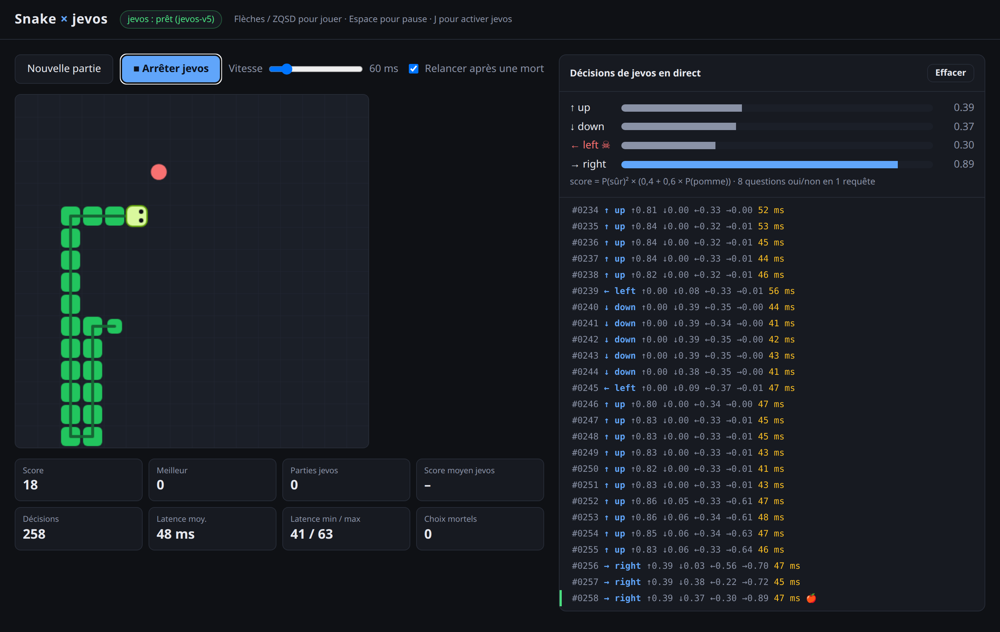
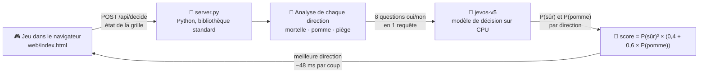

<h1 align="center">🐍 Snake × jevos</h1>

<p align="center">
  <strong>Un Snake dans le navigateur, jouable à la main ou piloté par un petit modèle de décision<br/>
  qui tourne sur le processeur (~48 ms par coup), avec chaque décision affichée en direct.</strong>
</p>

<p align="center">
  
  
  
  
  
</p>

---

Le jeu peut être piloté par **jevos**
([feder-cr/jev](https://github.com/feder-cr/jev)), un modèle de décision open source (MIT)
qui répond à des questions oui/non en quelques dizaines de millisecondes, sur le processeur.



## 🚀 Installer et lancer

Prérequis : Linux x64, Python 3, `curl`, `unzip`.

```bash
./setup.sh    # télécharge jevos-v5 (~650 Mo) dans jevos/  (fait automatiquement par start.sh)
./start.sh
```

Puis ouvrir http://127.0.0.1:8080

- Flèches / ZQSD : jouer · Espace : pause · J ou bouton « Jevos joue » : jevos prend la main
- Toucher une flèche pendant que jevos joue = reprise en main
- À droite : chaque décision en direct (cliquer une ligne pour voir le texte envoyé et les réponses)

`start.sh` lance jevos sur le port 8018 (modifiable : `JEVOS_PORT=8017 ./start.sh` réutilise un jevos déjà lancé).

## 🧠 Fonctionnement (mode « assisté »)



À chaque pas, `server.py` :

1. analyse la grille et décrit chaque direction en texte : mortelle (mur / corps), mange la pomme,
   rapproche ou éloigne de la pomme, piège (pas assez d'espace libre ensuite) ;
2. pose **8 questions oui/non** à jevos en une seule requête : pour chaque direction,
   « ce coup est-il sûr ? » et « rapproche-t-il de la pomme ? » ;
3. calcule `score = P(sûr)² × (0,4 + 0,6 × P(pomme))` et joue la direction au meilleur score.

jevos ne lit pas la grille brute (testé : 2/6 bonnes réponses, il répond « up » à chaque fois),
c'est pourquoi le code lui fournit des faits sur chaque direction.

## 📊 Mesures (grille 16×16, CPU 16 threads)

| Version des questions | Score moyen | Latence médiane |
|---|---|---|
| 1 question « meilleur coup ? » par direction | 15,8 (4 parties) | ~56 ms |
| 2 questions combinées (actuelle) | **54,6** (5 parties) | ~48 ms |

Avec la version actuelle, aucune mort ne vient d'un choix mortel : le serpent meurt quand il s'est
enfermé dans son propre corps (la détection de piège ne regarde qu'un coup à l'avance).

```bash
python3 tools/simulate.py 5      # rejoue 5 parties sans navigateur
```

## 📁 Dossiers

- `setup.sh` : télécharge jevos dans `jevos/` (non versionné, trop lourd pour Git)
- `start.sh` : lance jevos puis le jeu
- `web/index.html` : le jeu
- `server.py` : serveur web + lien avec jevos (bibliothèque standard Python uniquement)

## 👤 Auteur

**Cyril D'Houdetot** · [GitHub](https://github.com/DHoudetot-Cyril)
